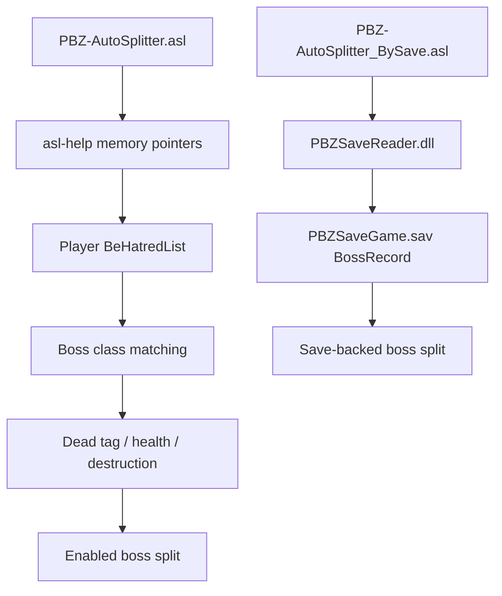

# Architecture

The default project uses live game memory for both loading detection and Boss
split tracking. The retained BySave variant independently tracks Boss records
from the save file.

## Data flow

## LiveSplit ASL

`Components/PBZ-AutoSplitter.asl` owns the default timer-facing behavior:

- memory pointer validation for the supported game build
- front-end and loading detection
- game-time pause state
- active Boss actor and combat-tag tracking
- Boss health/death/destruction handling
- pending split queue

The loading detection reads a layered pointer chain and resolves the current
world name from the Unreal `FName` pool. If any pointer or flag fails validation,
the script pauses rather than reporting gameplay.

The memory splitter watches the player's `BeHatredList`, matches actor classes to
the configured Boss settings, and splits on an observed `CharacterState.Dead`
tag, zero health, or a validated actor destruction edge. Because phase changes
use distinct actor classes and settings, an armed actor that leaves the list at
or below 2% health is split in the same update. Other removal edges retain a
sixty-second observation window for delayed death signals.

`Components/PBZ-AutoSplitter_BySave.asl` is the previous save-backed variant and
uses `PBZSaveReader.dll`; it remains available for comparison and fallback.

## Save reader

`Components/PBZSaveReader.dll` is loaded only by the BySave variant. It contains:

- container and index parsing
- AES-256-GCM decryption through Windows CNG
- discovery of `PBZSaveGame.sav`
- a streaming JSON parser limited to boss counters
- the clean-room Mermaid decoder
- an optional game-process fallback for unsupported compressed data

Only `__Advanced__` is decoded. The reader does not build a complete JSON object
graph and does not expose inventory, quest, or account data.

## Backend selection

`PBZ_ODLE_BACKEND=auto` is the production default:

1. Try the pure C# Mermaid decoder.
2. If it rejects the data, use the Oodle decoder embedded in `PBZ.exe`.

`PBZ_ODLE_FALLBACK=none` disables step 2. This is useful for strict clean-room
testing but is not the recommended end-user setting.

## Compatibility boundary

Save-file parsing depends on the PBZS container and `__Advanced__` schema.
Loading detection depends on game-build-specific memory offsets and module
size. A game update is therefore expected to require a fresh offset validation
even when save parsing continues to work.
