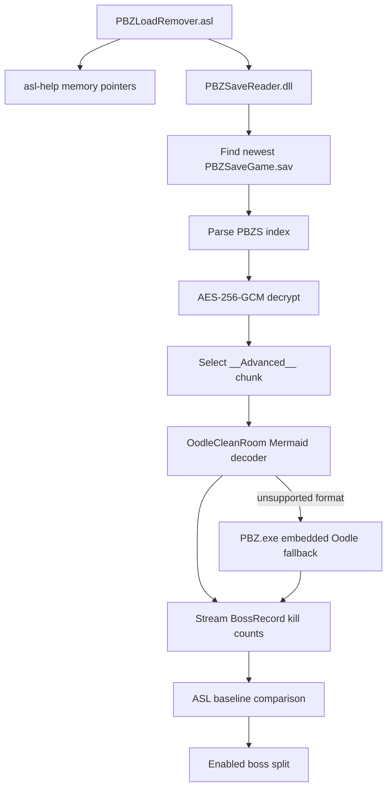

# Architecture

The project has two independent behaviors: loading detection from live game
memory and boss split tracking from the save file.

## Data flow

## LiveSplit ASL

`Components/PBZLoadRemover.asl` owns the timer-facing behavior:

- memory pointer validation for the supported game build
- front-end and loading detection
- game-time pause state
- save-file change detection
- boss baseline and pending split queue

The loading detection reads a layered pointer chain and resolves the current
world name from the Unreal `FName` pool. If any pointer or flag fails validation,
the script pauses rather than reporting gameplay.

## Save reader

`Components/PBZSaveReader.dll` is the only managed component loaded by the ASL.
It contains:

- container and index parsing
- AES-256-GCM decryption through Windows CNG
- discovery of `PBZSaveGame.sav`
- a streaming JSON parser limited to boss counters
- the clean-room Mermaid decoder
- an optional game-process fallback for unsupported compressed data

Only `__Advanced__` is decoded. The reader does not build a complete JSON object
graph and does not expose inventory, quest, or account data.

## Backend selection

`PBZ_ODLE_BACKEND=auto` is the production default:

1. Try the pure C# Mermaid decoder.
2. If it rejects the data, use the Oodle decoder embedded in `PBZ.exe`.

`PBZ_ODLE_FALLBACK=none` disables step 2. This is useful for strict clean-room
testing but is not the recommended end-user setting.

## Compatibility boundary

Save-file parsing depends on the PBZS container and `__Advanced__` schema.
Loading detection depends on game-build-specific memory offsets and module
size. A game update is therefore expected to require a fresh offset validation
even when save parsing continues to work.
